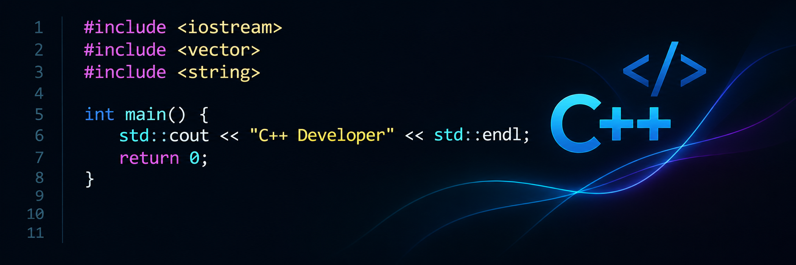

  

### 👋 A Little About Me

Hi, I'm Pedram! I'm a curious, motivated person who enjoys learning new things, solving problems, and challenging myself. I believe in continuous growth, creativity, and turning ideas into reality. I enjoy exploring technology, but above all, I value perseverance, curiosity, and meaningful progress.

# More About ME

### Aspiring C++ Developer | Desktop Applications

I'm an aspiring software developer/Game Developer focused on building desktop applications/Games with modern C++/Python.

I have a background in IT support and troubleshooting, and I'm currently expanding my skills in software development.

### 🛠 Tech Stack
- **Languages:** C++17, Python (Learning)
- **Frameworks:** Qt 6 Widgets
- **Tools:** CMake, Git, GitHub, VS Code
- **Technologies:** Windows API, WebView2
- **Currently Exploring:** SQLite, Desktop Application Architecture , Unreal Engine , Game Developing

### 🛠 Projects
- You can check my Repositories for more information .

### 📊 GitHub Stats

### 🎯 Current Goals
- Improve my C++ development skills
- Build reliable desktop applications
- Gain practical experience with software architecture
- Pursue opportunities as a Junior C++ Developer

### 📫 Connect
- Feel free to connect with me on: [LinkedIn](https://www.linkedin.com/in/pedram-ramin/)
- 

- You can also contact me via E-Mail :pedramramin4@gmail.com
- Or with the social accounts I added to my profile

